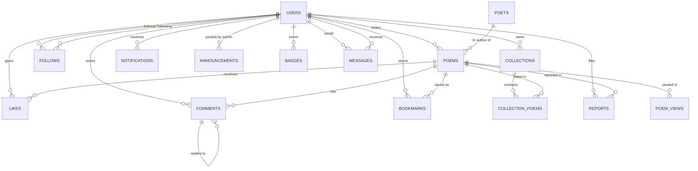

# Kavyavani on Oracle Database

Kavyavani runs on **SQLite by default** (nothing to set up) and on **Oracle** when you set three
environment variables. The website code is the same for both.

Needs Oracle Database **12c or newer** (Oracle XE 18c, 21c or 23ai). Oracle XE 11g is too old
(no identity columns).

## 1. Install Oracle XE and create the application user

1. Install Oracle Database XE and remember the password you gave the `SYS`/`SYSTEM` users.
2. Open SQL*Plus (or SQL Developer) and connect to the pluggable database as an admin:

   ```
   sqlplus system/<your_admin_password>@localhost:1521/XEPDB1
   ```

   (XE 18c and 21c use the pluggable database `XEPDB1`; Oracle Database 23ai Free uses `FREEPDB1`.)
3. Create the schema user that will own the tables:

   ```sql
   CREATE USER kavyavani IDENTIFIED BY "ChooseAStrongPassword1";
   GRANT CONNECT, RESOURCE TO kavyavani;
   ALTER USER kavyavani QUOTA UNLIMITED ON USERS;
   ```

## 2. Install the Python driver

```
pip install -r requirements.txt
```

`oracledb` runs in "thin" mode, so you do **not** need Oracle Instant Client.

## 3. Tell the website to use Oracle

Windows (Command Prompt):

```
set ORACLE_DSN=localhost:1521/XEPDB1
set ORACLE_USER=kavyavani
set ORACLE_PASSWORD=ChooseAStrongPassword1
```

Mac / Linux:

```
export ORACLE_DSN=localhost:1521/XEPDB1
export ORACLE_USER=kavyavani
export ORACLE_PASSWORD=ChooseAStrongPassword1
```

Without `ORACLE_DSN` the site keeps using `sukhan.db`.

## 4. Create the tables and load data

**Option A - keep your existing data (users, poems, likes, ...)** : run this once, *before* the
first start on Oracle. It creates the tables and copies everything out of `sukhan.db`:

```
python migrate_sqlite_to_oracle.py
```

**Option B - start empty**: just run `python app.py`. The tables are created automatically, plus the
default categories and the `admin` account.

Then load the poets and poems (these also run on Oracle):

```
python seed_poets.py
python import_poems.py
```

Prefer to create the tables by hand? `oracle/schema.sql` has the same schema; run it in SQL Developer
as the `kavyavani` user.

## 5. Start the website

```
python app.py
```

If it cannot connect you will see the Oracle error (wrong password, listener not running,
wrong service name). Check the DSN with: `sqlplus kavyavani/<password>@localhost:1521/XEPDB1`.

## The relational design

Every table has an auto-numbered primary key. Relationships are real foreign keys, so Oracle itself
refuses orphan rows (a like on a poem that does not exist) and cleans up children when a parent is
deleted (`ON DELETE CASCADE`).



| Table | Primary key | Foreign keys | Unique rules |
|---|---|---|---|
| users | id | | username, email |
| categories | id | | name |
| poets | id | | slug |
| poems | id | user_id -> users, poet_id -> poets (SET NULL) | |
| likes | id | user_id -> users, poem_id -> poems | one like per user per poem |
| comments | id | user_id, poem_id, parent_id -> comments | |
| follows | id | follower_id, following_id -> users | one follow per pair |
| bookmarks | id | user_id, poem_id | one per user per poem |
| collections | id | user_id -> users | |
| collection_poems | id | collection_id, poem_id | one per collection per poem |
| notifications | id | user_id -> users | |
| reports | id | reporter_id -> users, poem_id -> poems | |
| announcements | id | admin_id -> users | |
| badges | id | user_id -> users | one badge key per user |
| messages | id | sender_id, receiver_id -> users | |
| poem_views | id | poem_id -> poems, viewer_id -> users (SET NULL) | |

## Things that behave differently on Oracle

* Oracle treats an empty text as NULL. The website converts it back to an empty string when reading,
  so pages look the same, but a required column (a poem's title or text) cannot be saved empty.
* Searches ignore upper/lower case on both databases (the layer handles this).
* Data stays in Oracle between restarts and deploys, unlike a SQLite file on hosts that wipe the disk.
